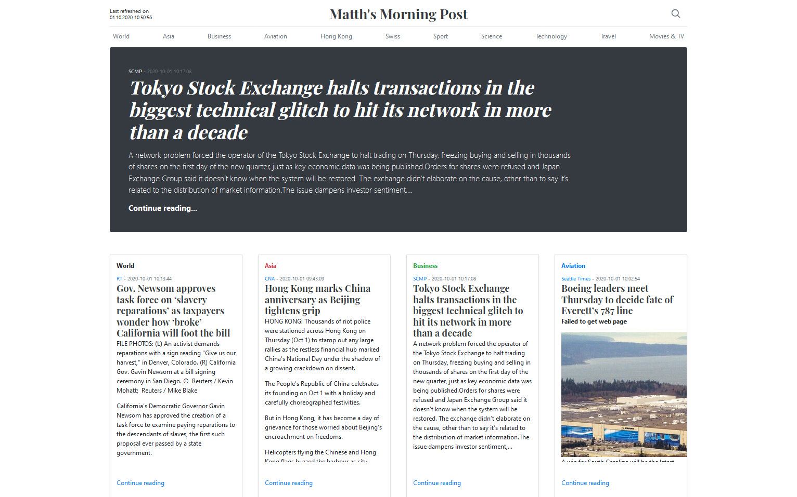
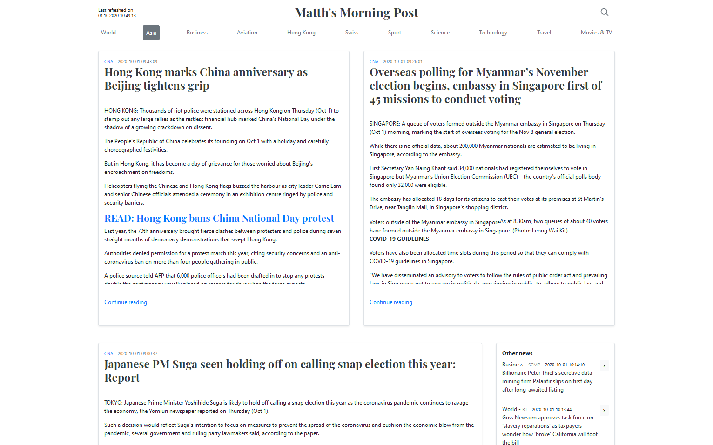
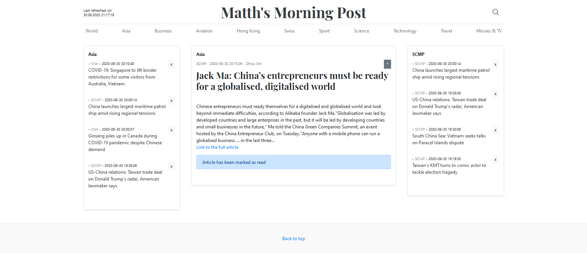
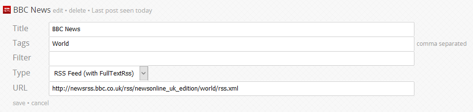

# selfoss - Webfront

This is a newspaper style webfront for the [selfoss RSS reader](https://github.com/fossar/selfoss),
bundled together with selfoss and a MySQL database into a single Docker Compose solution.

I never liked RSS readers very much as the user interface is just plain ugly. I wanted to have
a nice looking user interface that feels like a newspaper, and not like some technical list.
And ideally, I wanted to have the full article, and not just a teaser. When I came across selfoss
that can fetch the full article (with some limits), I felt I want to use that as a base for my
personal "Morning Post".

- Website that looks like a newspaper
- Based on Bootstrap blog [example](https://getbootstrap.com/docs/4.5/examples/blog/) (Bootstrap 4.6.2)
- Fixed to 11 categories

This repository consolidates everything that was previously spread over four repositories
(Selfoss-Webfront, Selfoss-WF-Docker, Selfoss-Docker and swfd) into one place: the webfront
application, the all-in-one Docker image and the Docker Compose stack.

## Features

- As it is based on a Bootstrap template, it is responsive and also works quite well on a mobile phone
- Content is mostly refreshed on regular intervals without a need to reload the page (on the main page and the list boxes on the other two pages)
- Articles that have been read are excluded from showing up again, unless the article is "starred". So you don't always see the same 10 news items that you have read already
- An article is automatically marked as read when you scroll to the end of the article or if it's fully visible, after a set threshold in seconds
- Articles can be marked read (made disappear) with a click on the x in the list boxes
- Articles with the same title are combined and only shown once (based on lowest date). So if a source shows the same item in different feeds it will only be shown once on the page
- Links to the source are opened in a new tab
- The category page scrolls infinitely, at least until there are no more articles
- List boxes with headlines (except on the start page) feature a "Show more" link to append more headlines
- Info or error messages show in toasts at the lower left of the screen
- You can search for keywords in titles or the content of the article (type words/search string or enclose them "with double quotes" to find the whole string)

## Limitations

- The content is displayed as it is in the database. So HTML code and images will be displayed as they are retrieved by selfoss and do "mess-up" the look to a certain extent
- The top lead article will show up again in one of the lower categories, but that is the only item showing up twice
- It currently is fixed to 11 categories or tags
- If a source has multiple tags, only the first is taken into account
- Similar articles from different sources are not combined. So the same topic will show up multiple times

## Screenshots

This is the main page with the overview of the categories/tags. There is a lead article on top, followed by the latest article from the top 8 categories.
Below that follows a list of a number of headlines for these 8 categories. At the bottom follows a full article for the remaining three categories, next to a list of some headlines in that category.

The category page shows the two latest articles on top, followed by a list of headlines with teasers and a list of headlines from other categories.

The article page shows a single article in the middle, while the left hand shows a list of headlines for that category, and the right shows a list of headlines from the same source.

## Quick start with Docker Compose

Everything (selfoss, the webfront and a MySQL database) runs with a single `docker compose up`.

Requirements: Docker with the Compose plugin.

1. Clone this repository and change into the directory
   `git clone https://github.com/MatthK/Selfoss-Webfront && cd Selfoss-Webfront`
2. Create your local configuration: `cp .env.example .env` and set a database password
   (generate one with `openssl rand -base64 24`). Adjust the host ports if 80/8080 are
   already in use on your machine.
3. Start the stack: `docker compose up -d`. The image is built locally from this repository
   on first start, and the database initializes itself. The `HTML_UnEncode` function needed
   by the webfront is installed automatically, and feeds are refreshed every 15 minutes
   (configurable with `SELFOSS_UPDATE_INTERVAL`).
4. Go to <http://ip-address:8080/> to get to the selfoss interface and create your RSS feeds
   (see "Setting up your feeds" below). The tags you assign there have to match the
   categories in the next step.
5. Adjust the 11 categories in `config/constants.php` to match your tags
   (Note: the file has 12 categories, `Top` is used for the jumbotron at the top of the
   index page. Do not modify that line.)
6. Your personal newspaper is then available at <http://ip-address/>
7. Optional, put a reverse proxy in front to give it a nice domain name and TLS
8. Enjoy

### Setting up your feeds

Make sure to use the "RSS Feed (with FullTextRss)" type when adding a source in selfoss.
This pulls the full article into your database instead of just the teaser from the RSS feed.

In the Tags field you can enter multiple values, but the webfront only considers the first value.

A list of feed suggestions is kept in the [swfd README](https://github.com/MatthK/swfd#sample-feeds)
(the old repository, still valid).

### Updating

- To upgrade the stack, `git pull` and `docker compose up -d --build`.
- Release images for `linux/amd64` and `linux/arm64` are also published on Docker Hub as
  [matthk72/selfoss-wf](https://hub.docker.com/r/matthk72/selfoss-wf) whenever a version tag
  is pushed. To use a published image instead of building locally, remove the `build` and
  `pull_policy` lines from `docker-compose.yml`.
- Your data (database and selfoss data) lives in the `db-data` and `selfoss-data` volumes and
  survives updates.

### Migrating from the old swfd stack

If you are currently running the old [swfd](https://github.com/MatthK/swfd) Docker Compose setup:

1. **Rotate your database password first.** The old swfd repository published the MySQL
   password in plain text on GitHub (`docker-compose.yml`, `swfd/Selfoss/config.ini` and
   `swfd/Webfront/constants.php`). Treat it as compromised and choose a new one.
2. Stop the old stack and dump the database:
   `docker exec MySql mysqldump -u root -p selfoss > selfoss-backup.sql`
3. Start the new stack (see above) with your new password, then restore the dump:
   `docker exec -i selfoss-webfront-db-1 mysql -u root -p selfoss < selfoss-backup.sql`
4. Copy your feed configuration from the old `swfd/Selfoss/config.ini` to
   `config/selfoss.ini` (omit `db_*` values, they come from `.env` now) and your categories
   from the old `swfd/Webfront/constants.php` to `config/constants.php`.
5. The old repositories are superseded by this one and can be archived.

## Manual installation (without Docker)

You need to have [selfoss](https://github.com/fossar/selfoss) installed first. Please revert
to that installation instructions to get selfoss going first. Use a MySQL database as the
backend to make sure it works out of the box. I have not tried it with Sqlite or PostgreSQL
databases. It might work, but I haven't tested it.

Also when you setup your feeds in selfoss, make sure to use the "RSS Feed (with FullTextRss)"
in Type. This should pull the full article to your database instead of just the teasers from
the RSS feed itself.

1. To keep things clean(er), I suggest to create a separate virtual website/host on the same
   (or a different) machine. I have used an nginx webserver and this tutorial on Step 5 shows
   the [basics](https://www.digitalocean.com/community/tutorials/how-to-install-nginx-on-ubuntu-20-04).
   Set `index.php` as the index page so it defaults to that page.
2. Clone the repository into the folder where you want to host the site and point the
   document root of the virtual host at it.
3. Adjust the settings/variables in the `includes/constants.php` file. There are comments in
   the file. You have to define your database details and also add the 11 categories/tags in
   the array below. The first column is for the visible category names. These can include
   spaces, while the second column should avoid spaces or special characters.
4. You have to create a function in the database. Simply run the `db/HTML_UnEncode.sql` in
   the MySQL database once to create the function. Creating stored functions requires binary
   logging to be disabled (or `log_bin_trust_function_creators=1`) for a non-superuser.
5. Enjoy
6. Optional: Add a reverse proxy in front (or open the port) to the virtual website to have
   access to the newspaper from outside your network.

## Configuration

1. Define the settings of your database (tested with MySQL; other databases may work)
2. Define the name of your "newspaper" and choose the font
3. Define your categories (11 needed)

## Security notes

- **No secrets in this repository.** All credentials for the Docker stack are supplied
  through `.env` (git-ignored) and environment variables. Please rotate any credentials you
  may have published in the old swfd repository.
- The webfront API endpoints (`api/`) have no authentication and can mark articles as
  read/unread. This mirrors the original design of a personal, single-user newspaper. Keep
  the stack on a trusted network or behind an authenticated reverse proxy.
- **Selfoss UI on port 8080:** with an empty username/password in `config/selfoss.ini`,
  selfoss runs in public mode and everyone who can reach the port has full admin access.
  If you expose the stack beyond your trusted network, set `username` and `password`
  (selfoss hashes the password on the login page, or see the selfoss documentation).
- The webfront is read-only except for the marking endpoints. Read articles and starred
  articles are handled by selfoss as usual.

## Architecture

The Docker image is an all-in-one Apache container based on `php:8.3-apache` with:

| Port | Content | Document root |
|------|---------|---------------|
| 80   | Selfoss-Webfront (the newspaper) | `/var/www/webfront` |
| 8080 | Selfoss (feed management UI) | `/var/www/html` |

- Selfoss is installed from the official release zip (default `2.19`, override with
  `--build-arg SELFOSS_VERSION=...`). Credentials are injected via `SELFOSS_DB_*`
  environment variables (selfoss `env_prefix` feature), so `config/selfoss.ini`
  contains no secrets.
- The entrypoint installs the `HTML_UnEncode` SQL function (retrying until MySQL is up),
  creates selfoss' data directories and runs `cliupdate.php` every
  `SELFOSS_UPDATE_INTERVAL` seconds (900 by default, 0 disables).
- MySQL 8.4 runs with `utf8mb4` and binary logging disabled (required to create the
  stored function as a non-privileged user). It is not exposed to the host.

### Building and publishing images

- Build locally: `docker build -f docker/Dockerfile -t selfoss-wf .`
- Multi-arch release builds (linux/amd64 + linux/arm64) happen automatically via
  [GitHub Actions](.github/workflows/docker-release.yml) when a `v*` tag is pushed, and
  are published to Docker Hub as `matthk72/selfoss-wf`. Requires the repository secrets
  `DOCKERHUB_USERNAME` and `DOCKERHUB_TOKEN`.

## Development

Please excuse the spaghetti code. But it does work, so...

## Credits

Thanks to awesome selfoss, as without that this wouldn't be possible.
And thanks to Stackoverflow and countless other pages/forums to help me get my code done.
